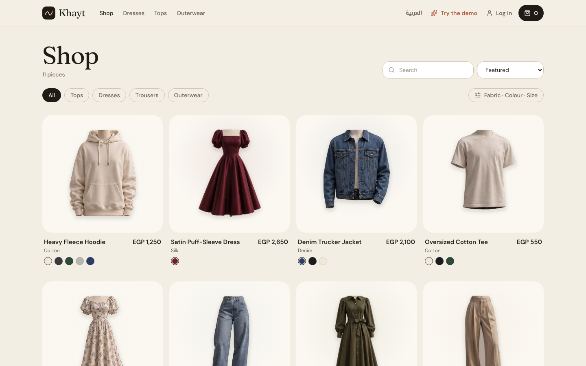
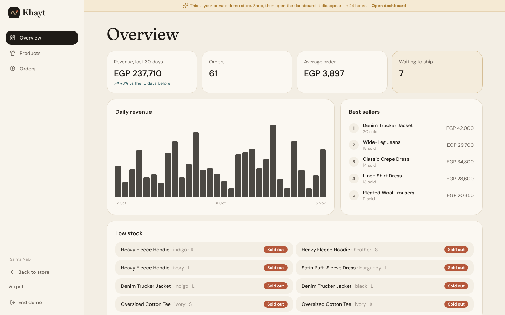
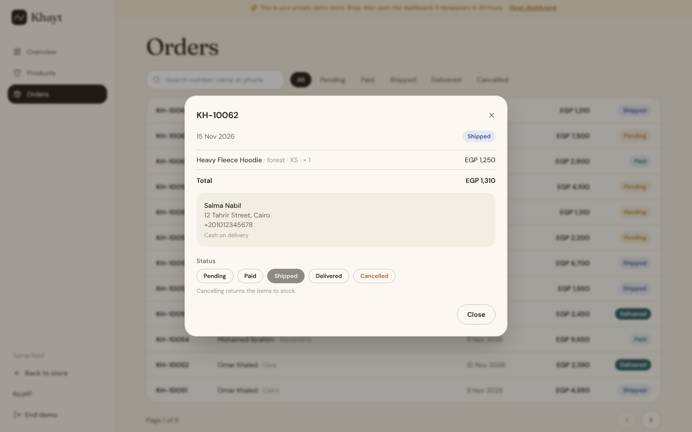
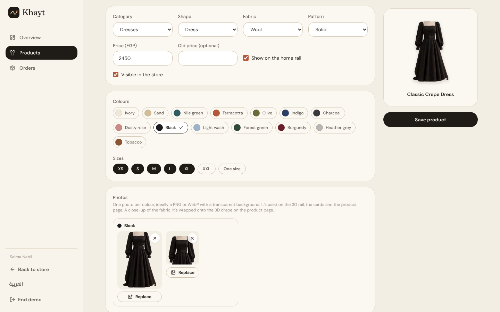
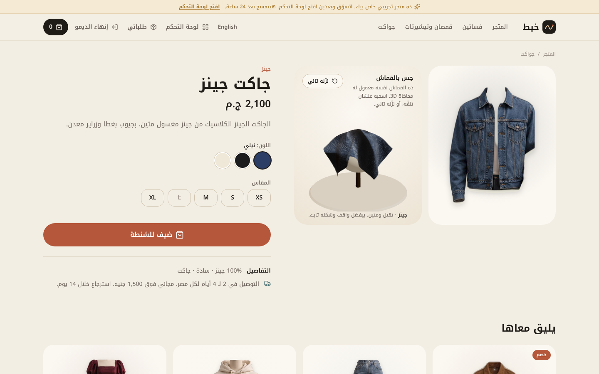
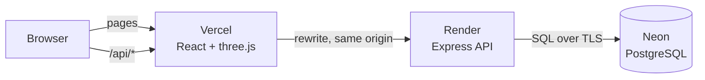

<div align="center">

# Khayt · خيط

**A clothing store you can almost touch.**

A full-stack e-commerce site where clothes hang on a swinging 3D rail, every fabric drapes in a live cloth simulation, and the catalogue ripples like cloth. It comes with a real cart, checkout, accounts and an admin dashboard, in English and Arabic.

[**Live demo**](https://khayt-sand.vercel.app) · [Features](#features) · [How it works](#how-the-backend-works) · [Run locally](#run-locally) · [Deploy](#deploy)


</div>

## Try it in 30 seconds

1. Open **[khayt-sand.vercel.app](https://khayt-sand.vercel.app)** and scroll. The rail slides and the clothes swing.
2. Open any product and watch its fabric fall and settle. Switch colours or press **Drop again**.
3. Click **Try the demo**. You get your own private copy of the store with 30 days of orders, and you're logged in as its admin.
4. Buy something, then open the dashboard and watch your order arrive. Upload a product photo too if you like.
5. Switch to **العربية** for the full right-to-left version.

> The API runs on a free server that sleeps when nobody is using it, so the very first load can take up to a minute. After that it's fast.

## Features

### The creative parts

| | |
| --- | --- |
| **🧥 The swinging rail** | A three.js scene of garments on wooden hangers along a brass rail. Scrolling slides the rail. Each piece is a pendulum driven by the rail's acceleration, so clothes swing when you speed up and settle when you stop, and light fabrics swing more than heavy ones. Flat product photos get real volume: a distance field built from each photo's transparency puffs the middle of the garment out, with a front and back panel lit by a physical fabric material with sheen. |
| **🌊 Feel the fabric** | A real cloth simulation on every product page: a 38 × 38 particle grid held together by structural, shear and bending springs (Verlet integration). It falls onto a 3D form, catches on it and settles into folds. Silk slides and shines, denim is stiff and heavy, linen is crisp, wool is soft. The cloth is textured with a close-up photo of that colour's actual fabric. |
| **💧 Liquid catalogue** | Hovering a product card runs a spring-damped SVG displacement ripple, so the garment wobbles like fabric and settles back. It needs no WebGL, so it stays smooth across a full grid on a phone. |

Keyboard and screen-reader users get the rail's products as a hidden list, the 3D scenes fall back gracefully without WebGL, and reduced-motion settings are respected.

### The store

- **Shop:**
  - Categories, and search in English and Arabic.
  - Filters for fabric, colour and size in stock, plus sorting.
  - Sale prices and sold-out badges.
- **Product page:**
  - Colour and size picker with live stock for every combination ("Only 2 left", crossed-out sold-out sizes).
  - Related pieces.
- **Cart:** a slide-out bag with quantity limits and a free-delivery progress bar. It's saved on the device.
- **Checkout:**
  - Egyptian mobile validation that accepts Arabic digits.
  - Cash on delivery, or a demo card payment.
- **Accounts:** register, log in, order history, and an order page with a progress tracker.
- **Admin dashboard:**
  - **Overview:** 30-day revenue chart, average order, orders waiting to ship, best sellers and low-stock alerts.
  - **Products:** bilingual names, fabric, pattern, colours and sizes, with a stock grid and a live preview.
  - **Photos:** a cut-out photo and a fabric close-up for each colour. Images are resized to WebP in the browser, checked on the server by their real bytes, and stored in Postgres.
  - **Orders:** search, filter, and move orders through *Pending → Paid → Shipped → Delivered*. Cancelling returns the stock.
- **Arabic and English:** full RTL layout, Arabic typography and a translated catalogue.

## Screenshots

| Product with live drape | Shop |
| --- | --- |
|  |  |

| Fabrics: linen, satin, denim | Bag |
| --- | --- |
|  |  |

| Dashboard | Orders | Product photos |
| --- | --- | --- |
|  |  |  |

| Arabic product page | Arabic dashboard | Mobile |
| --- | --- | --- |
|  |  |  |

## Architecture



The browser only ever talks to Vercel. Vercel forwards `/api/*` to the API on Render, so the session cookie stays first-party and `HttpOnly`, with no cross-site cookie problems.

## Tech stack

| | |
| --- | --- |
| **Frontend** (`client/`) | React 19, TypeScript, Vite, Tailwind CSS v4, three.js with React Three Fiber, React Router 7, TanStack Query |
| **API** (`server/`) | Node 20+, Express 5, TypeScript, Drizzle ORM, zod, jose (JWT), bcryptjs, helmet, express-rate-limit |
| **Database** | PostgreSQL on Neon. Locally it falls back to embedded PGlite, so no database install is needed. |
| **Tests** | Vitest and Supertest against a fresh in-memory database |
| **Hosting** | Vercel (frontend), Render (API), Neon (database), all on free plans |

## How the backend works

- **Multi-store by design:**
  - Every product, order and user belongs to a store, and the public site is the main store.
  - **Try the demo** creates a new store with the full catalogue and 30 days of realistic orders, so visitors can do anything without touching the real data.
  - Demo stores are deleted on logout or after 24 hours.
- **Safe checkout in one transaction:**
  1. It locks every stock row it needs (`SELECT … FOR UPDATE`) and checks quantities.
  2. It takes prices from the database, never from the browser.
  3. It decrements stock and writes the order with a per-store number like `KH-10001`.
  - If something changed meanwhile, it returns `409 cart_changed` with the exact problems, and the bag fixes itself.
- **Stock per colour and size:** stored in its own table. Cancelling an order returns its items.
- **Privacy:** customers see only their own orders, and admins only their own store. Other stores' IDs return 404, and tests check this.
- **Security:**
  - `HttpOnly` session cookie.
  - Origin check and content-type checks on every write.
  - bcrypt passwords, with constant-time login.
  - zod validation, rate limits and escaped search.
  - Uploaded images are verified by their real bytes.

## API

| Method | Route | |
| --- | --- | --- |
| POST | `/api/auth/register` · `/login` · `/logout` · `/demo` | Sessions and demo stores |
| GET | `/api/auth/me` | Current user |
| GET | `/api/meta` | Palette, sizes and shipping rules |
| GET | `/api/products?category&fabric&color&size&q&sort&featured` | Catalogue |
| GET | `/api/products/:slug` | Product with stock and related pieces |
| POST, GET | `/api/orders` | Place an order, list my orders |
| GET | `/api/orders/:id` | Order detail (owner or the store's admin) |
| GET | `/api/admin/stats` | Dashboard numbers |
| GET, POST, PUT, DELETE | `/api/admin/products[/:id]` | Manage products and stock |
| POST | `/api/admin/images` | Upload a product photo |
| GET | `/api/images/:id` | Serve an uploaded photo |
| GET | `/api/admin/orders?status&q&page` | Orders |
| PUT | `/api/admin/orders/:id/status` | Change an order's status |
| GET | `/api/health` | Health check |

## Run locally

You need Node 20 or newer. No database setup is needed.

```bash
npm run install:all
npm run dev:api
npm run dev:web
```

Open http://localhost:5173. The API runs on port 4000 with a local PGlite database that seeds itself on first start. The local admin login is `admin@khayt.shop` / `khayt2026`.

```bash
npm test
npm run build
```

## Deploy

Everything below runs on free plans.

**1. Database on Neon**
- Create a project. Pick the **Frankfurt** region, or whichever is closest to your users.
- Click **Connect**, turn on **Connection pooling**, click **Show password**, and copy the connection string.
- Remove `&channel_binding=require` from the end, so it ends with `?sslmode=require`.

**2. API on Render**
- Choose **New → Blueprint** and pick this repo. `render.yaml` sets up the service (`server/` folder, Frankfurt region, free plan, health check).
- Fill in:
  - `DATABASE_URL`: the Neon string from step 1.
  - `CLIENT_URL`: your Vercel URL, exactly, like `https://your-app.vercel.app` with no slash at the end.
  - `ADMIN_EMAIL` and `ADMIN_PASSWORD`: optional. Set them only if you want an admin login for the main store; the demo works without them.
  - `JWT_SECRET` is generated for you.
- On first start the API creates its tables and seeds the store.

**3. Frontend on Vercel**
- In `client/vercel.json`, point the `/api` rewrite at your Render URL.
- Import the repo with **Root Directory** set to `client`.

**Check it:** open `https://your-app.vercel.app/api/health`. If you get `{"ok":true,…}`, the browser → Vercel → Render → Neon chain works.

| Problem | Fix |
| --- | --- |
| `password authentication failed` in the Render logs | The connection string has a placeholder or hidden password. Copy it again from Neon with **Show password**. |
| Sign-in or checkout returns `bad_origin` | `CLIENT_URL` doesn't exactly match the site's address. |
| `/api/health` shows the site's 404 page | Vercel hasn't redeployed with the updated `vercel.json`. |
| First request takes ~1 minute | Normal on Render's free plan: the API sleeps after 15 idle minutes. |

---

<div align="center">

Designed and built by **[Mariam Hussein](https://www.mariam-hussein.website)**

<sub>The brand and products are fictional, and the product and fabric photos are AI-generated.</sub>

</div>
