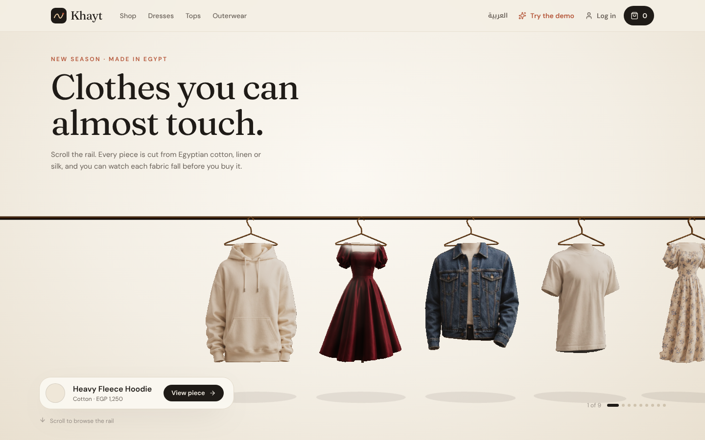
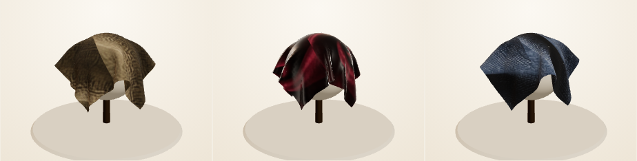
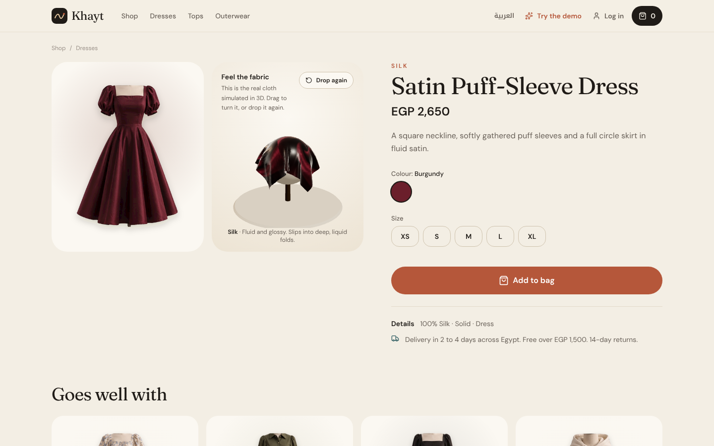
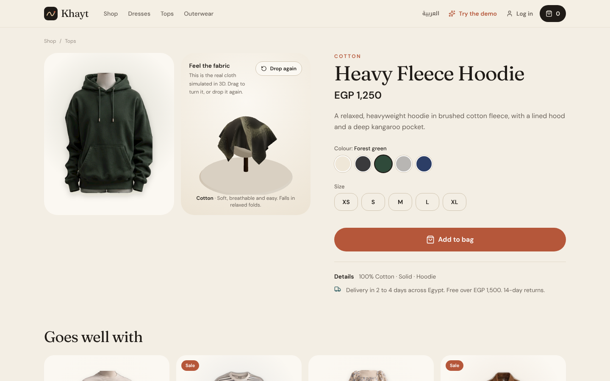
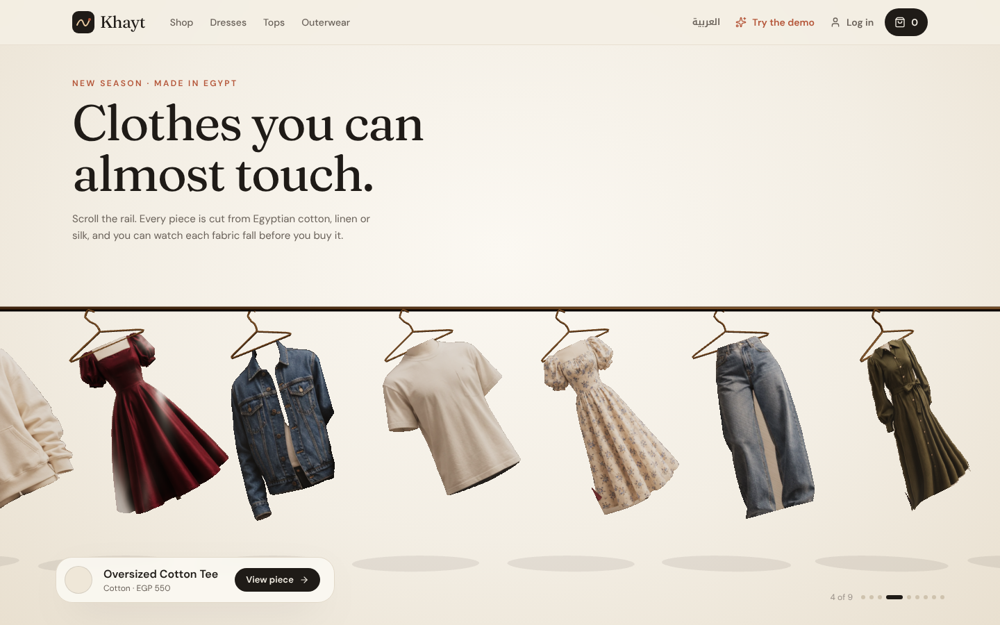
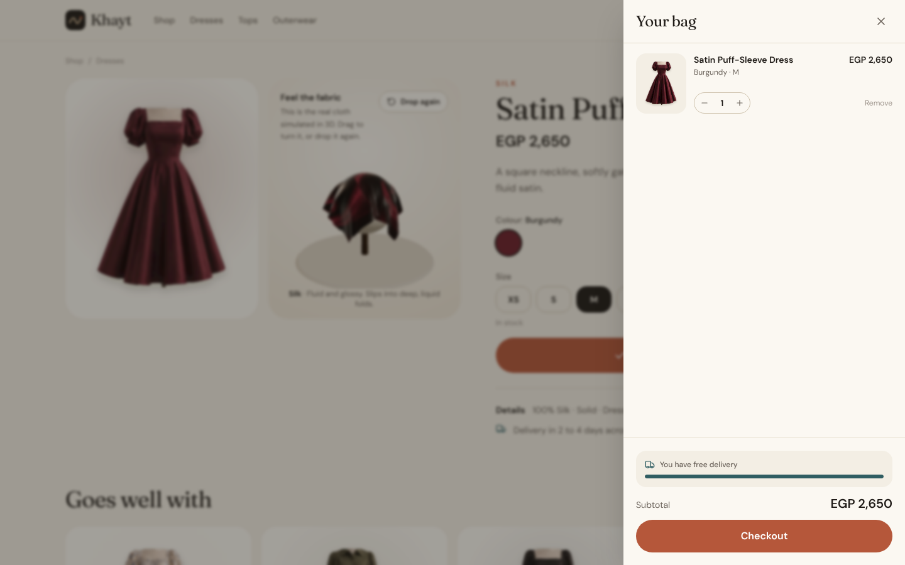
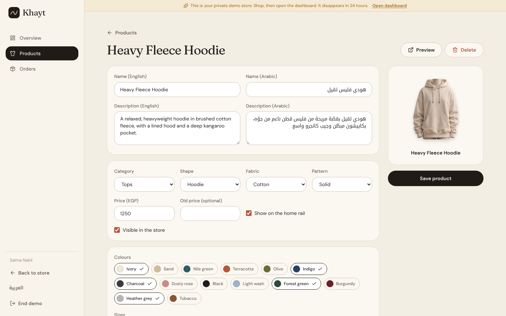
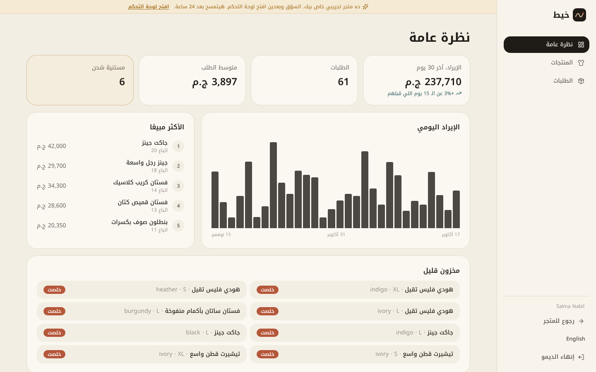
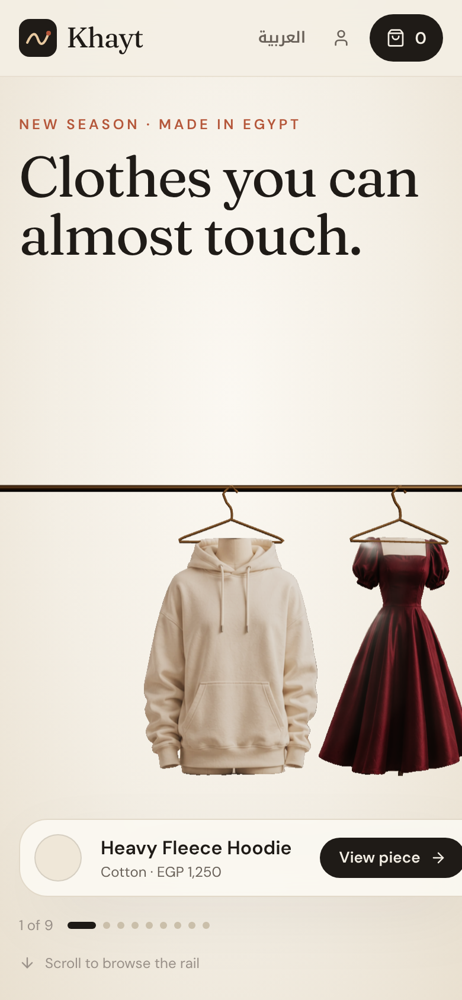

# Khayt · خيط

**A clothing store you can almost touch.** Khayt is a full-stack e-commerce site for a fictional Egyptian clothing brand. Real product photos hang on a 3D rail that sways as you scroll, every product shows its actual fabric draping in real time, and the catalogue ripples like cloth when you hover. It comes with a cart, checkout, customer accounts and an admin dashboard, in English and Arabic.

**Live demo:** _add your Vercel link here_. Click **Try the demo** to get your own private copy of the store. Shop in it, then open the dashboard and see your order arrive.

> A portfolio project by [Mariam Hussein](https://www.mariam-hussein.website). The brand and products are fictional, and the product and fabric photos are AI-generated.



## The creative parts

### 1. The rail (home page)
- **What it is:** a three.js scene of garments on wooden hangers along a brass rail. Scrolling the page slides the rail.
- **Swinging:** each garment is a pendulum driven by the rail's acceleration, so pieces swing when you speed up and settle when you stop. Lighter fabrics swing more than heavy ones.
- **The cloth:** each garment is a 26 × 34 vertex mesh with a front and a back panel. A distance field computed from the photo's transparency puffs the middle out, so a flat cut-out gets real volume. It's deformed every frame with fabric-dependent waves that grow toward the hem, and lit with a physical material with fabric sheen.
- **The look:** each colour of a product has its own transparent photo. Products without a photo fall back to a garment drawn in code, with woven texture, folds, stitching and a generated normal map.
- **Interaction:** hovering lifts a piece toward you, and clicking opens it. Keyboard and screen-reader users get the same products as a hidden list. There's a flat fallback without WebGL.

### 2. Feel the fabric (product page)
- **What it is:** a real cloth simulation with Verlet integration: a 38 × 38 particle grid held together by structural, shear and bending springs. It falls onto a 3D form, catches on it, and settles into folds.
- **Each fabric behaves differently:**
  - **Silk:** almost no bending stiffness, slippery and glossy.
  - **Denim:** stiff and heavy.
  - **Linen:** crisp.
  - **Wool:** soft, with body.
- **Real fabric:** the cloth is textured with a close-up photo of that colour's fabric (fleece, denim, satin, corduroy, crepe…).
- **Interaction:** colours swap live. You can drag to rotate it, or press **Drop again** to replay it.



### 3. Liquid catalogue (shop)
- Product photos sit inside an SVG with a soft shadow; drawn products get fabric-specific turbulence noise and folds.
- Hovering a card runs a spring-damped `feDisplacementMap` ripple, so the garment wobbles like fabric and settles back.
- It's cheap enough for a full grid on a phone, with no WebGL needed.

## Store features

- **Shop:** categories, search in English and Arabic, filters (fabric, colour, size in stock), sorting, sale prices and sold-out badges.
- **Product page:** colour and size picker with live stock per colour and size ("Only 2 left", crossed-out sold-out sizes) and related pieces.
- **Cart:** a slide-out drawer with quantity limits and a free-delivery progress bar (free over EGP 1,500). It's saved on the device.
- **Checkout:**
  - Delivery details with Egyptian mobile validation (Arabic digits accepted).
  - Cash on delivery, or a demo card payment that marks the order paid.
- **Accounts:** register, log in, order history, and an order page with a progress tracker.
- **Admin dashboard:**
  - 30-day revenue chart, order count, average order, orders waiting to ship, best sellers and low stock.
  - **Products:** create and edit with bilingual names, shape, fabric, pattern, colours, sizes and a stock grid for every colour and size, with a live preview.
  - **Photos:** upload a cut-out photo and a fabric close-up for each colour. Images are resized to WebP in the browser, checked on the server by their real bytes (PNG, JPEG or WebP only, 64 to 4000 px), stored in Postgres and served with long-lived caching. Deleting a product that has been ordered hides it instead.
  - **Orders:** search, status filter, and a detail view to move an order through *Pending, Paid, Shipped, Delivered*. Cancelling returns the stock.
- **Arabic and English:** full RTL layout, Arabic fonts, translated catalogue, and Western digits.

## Screenshots

| Product with live drape | Shop |
| --- | --- |
|  |  |

| Another colour | Photo upload |
| --- | --- |
|  |  |

| Rail in motion | Bag |
| --- | --- |
|  |  |

| Dashboard | Orders | Product editor |
| --- | --- | --- |
|  |  |  |

| Arabic product page | Arabic dashboard | Mobile |
| --- | --- | --- |
|  |  |  |

## Tech stack

| | |
| --- | --- |
| **Frontend** (`client/`) | React 19, TypeScript, Vite, Tailwind CSS v4, three.js with React Three Fiber, React Router 7, TanStack Query |
| **API** (`server/`) | Node 22, Express 5, TypeScript, Drizzle ORM, zod, jose (JWT), bcryptjs, helmet, express-rate-limit |
| **Database** | PostgreSQL (Neon in production). It falls back to embedded PGlite when `DATABASE_URL` isn't set. |
| **Tests** | Vitest and Supertest against a fresh in-memory database |
| **Hosting** | Vercel for the frontend, Render for the API, Neon for the database |

## How the backend works

- **Stores (tenants):** every product, order and user belongs to a store. The public site is the main store.
  - **Try the demo** creates a new store with the full catalogue and 30 days of realistic orders, and logs the visitor in as its admin.
  - The storefront and dashboard then show *their* store, so nobody can change the real catalogue.
  - Demo stores are deleted on logout or after 24 hours.
- **Stock per colour and size:** stored in its own table.
- **Checkout is one transaction:**
  1. It locks every stock row it needs (`SELECT … FOR UPDATE`) and checks the quantities.
  2. It takes prices from the database, never from the browser.
  3. It decrements stock and writes the order with a per-store number (`KH-10001`).
  - If anything changed, it returns `409 cart_changed` with the exact problems, and the bag updates itself.
- **Cancelling:** returns the items to stock. A cancelled order can't be reopened.
- **Privacy:** a customer sees only their own orders, and admins only their own store. Another store's IDs return 404, and tests check this.
- **Security:**
  - `HttpOnly` session cookie, served same-origin through a Vercel rewrite.
  - Origin check and JSON-only bodies on writes.
  - bcrypt passwords, with login taking the same time whether or not the email exists.
  - zod validation, rate limits and escaped searches.

## API

| Method | Route | |
| --- | --- | --- |
| POST | `/api/auth/register` · `/login` · `/logout` · `/demo` | Sessions and demo stores |
| GET | `/api/auth/me` | Current user |
| GET | `/api/meta` | Palette, sizes and shipping rules |
| GET | `/api/products?category&fabric&color&size&q&sort&featured` | Catalogue |
| GET | `/api/products/:slug` | Product with stock per colour and size, and related pieces |
| POST, GET | `/api/orders` | Place an order, list my orders |
| GET | `/api/orders/:id` | Order detail (owner or the store's admin) |
| GET | `/api/admin/stats` | Dashboard numbers |
| GET, POST, PUT, DELETE | `/api/admin/products[/:id]` | Manage products and stock |
| POST | `/api/admin/images` | Upload a product photo (raw image body) |
| GET | `/api/images/:id` | Serve an uploaded photo |
| GET | `/api/admin/orders?status&q&page` | Orders |
| PUT | `/api/admin/orders/:id/status` | Change status |

## Run locally

```bash
npm run install:all
npm run dev:api
npm run dev:web
```

Open http://localhost:5173. The API runs on port 4000 with a local PGlite database, seeded on first start. The main store's admin login is `admin@khayt.shop` / `khayt2026`, unless `ADMIN_EMAIL` and `ADMIN_PASSWORD` are set.

```bash
npm test
npm run build
```

## Deploy

1. **Neon:** create a free Postgres database and copy its connection string.
2. **Render:** choose **New → Blueprint** and pick this repo (`render.yaml`). Set:
   - `DATABASE_URL`: the Neon connection string.
   - `CLIENT_URL`: your Vercel URL.
   - `ADMIN_EMAIL` and `ADMIN_PASSWORD`: the main store's admin account.
   - `JWT_SECRET` is generated for you.
3. **Vercel:** import the repo with the root directory set to `client`, put your Render URL in place of `YOUR-API` in `client/vercel.json`, and deploy.

> On Render's free plan the API sleeps after 15 minutes without traffic, so the first request after that can take about a minute.

---

Built by [Mariam Hussein](https://www.mariam-hussein.website)
